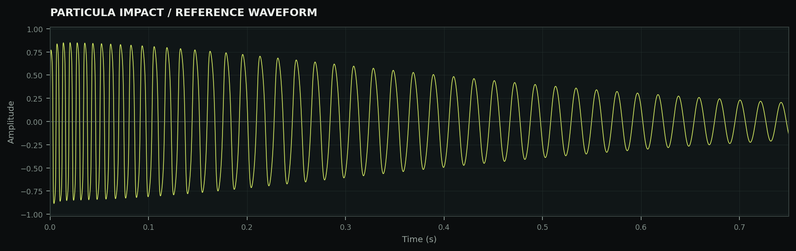
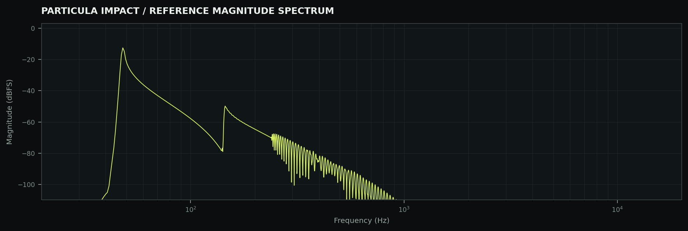

# Particula Primordial Kick Laboratory: A Procedural Impact Synthesizer with a Reproducible Analysis Interface

**Technical note · Version 0.1 · 18 November 2026**  
**Project:** Particula Primordial — Computational Composer & Producer  
**Status:** Research prototype; not a peer-reviewed publication

## Abstract

This technical note describes a procedural kick and short mono-bass synthesizer implemented as a Python digital-signal-processing engine and a Streamlit analysis interface. The instrument is organized around a time-varying oscillator whose instantaneous frequency follows an exponential trajectory from a start frequency to a target frequency. Harmonic character is modified through waveform morphing, frequency modulation (FM), wavefolding, transient excitation, noise and click layers, filtering, and nonlinear saturation. An amplitude envelope controls the decay of the event, while a MIDI-style velocity parameter provides repeatable dynamic variation. The interface exports 48 kHz WAV files and displays time-domain and frequency-domain measurements. A separate Max patch provides a minimal MIDI-triggered voice as a starting point for a future Ableton Live instrument. Version 0.1 establishes an executable research baseline; it does not claim feature parity with commercial Max for Live synthesizers, nor does it claim that the Max patch has been compiled into an `.amxd` device.

**Keywords:** procedural synthesis, kick drum, transient design, pitch envelope, frequency modulation, waveform morphing, digital audio, Max for Live, Streamlit, reproducible sound design.

---

## 1. Introduction

The kick drum is a short-duration sound whose perceived identity depends on more than its steady-state spectrum. The initial transient, pitch trajectory, low-frequency body, decay envelope, harmonic distortion and playback context all contribute to its perceptual result. A procedural synthesizer provides direct access to these parameters and makes it possible to generate repeatable variations without relying on a fixed sample.

The project goal is to create a compact, inspectable system for designing and documenting kick sounds. The system separates two tasks:

1. **Sound generation:** deterministic parameterized synthesis and WAV export.
2. **Sound inspection:** waveform display, FFT magnitude analysis and level measurements in a browser dashboard.

The supplied Rupture description served as a functional reference for the category of instrument—morphable oscillator, envelopes, velocity, FM, filters, layers, snapshots and analysis. Particula Primordial uses an independently authored signal path, interface and codebase. This is not a reverse-engineering claim and no proprietary source or assets are included.

## 2. Methods

### 2.1 System architecture

The prototype contains four modules:

- `particula_dsp.py`: pure Python rendering functions.
- `app.py`: Streamlit controls, session snapshots, audio preview, plots and export.
- `max_for_live/`: a starter Max patch source with MIDI note input and a mono kick voice.
- `tests/`: automated checks for deterministic rendering, finite output and WAV encoding.

The Python reference engine operates offline. It is not loaded as a plugin inside Ableton Live. The Max patch is a separate implementation path intended for migration into a Max for Live Instrument template.

### 2.2 Sample representation

Let the sample rate be \(f_s\), the event duration be \(T\), and the discrete time index be \(n\). The time vector is

\[
 t_n = \frac{n}{f_s}, \quad n=0,1,\ldots,\lfloor Tf_s\rfloor-1.
\]

The current default is \(f_s=48\,000\) samples/s and \(T=1.35\) s. The internal render is mono, floating point and subsequently encoded as 16-bit PCM for WAV export.

### 2.3 Exponential pitch trajectory

The instantaneous frequency moves from \(f_{start}\) to \(f_{end}\) according to

\[
 f(t)=f_{end}+(f_{start}-f_{end})\exp\left[-\left(\frac{t}{\tau_p}\right)^c\right],
\]

where \(\tau_p\) is the pitch-decay time constant and \(c\) is the curve parameter. The oscillator phase is obtained by discrete integration:

\[
 \phi[n]=\phi[n-1]+2\pi\frac{f[n]}{f_s}.
\]

The phase trajectory is then passed to the oscillator basis. This formulation makes the pitch motion continuous in time and permits the start and end frequencies to be inspected independently of the timbral layers.

### 2.4 Oscillator morphology

The source waveform is one of four harmonic bases: sine, triangle, saw or square. The morphology control blends the sine foundation with the selected basis:

\[
 x_m[n]=(1-m)\sin(\phi[n])+m\,w(\phi[n]),\quad m\in[0,1],
\]

where \(w\) is the selected harmonic waveform. Triangle, saw and square sources are constructed using truncated Fourier series. They are intended as compact timbral bases for short impacts, not as a claim of fully band-limited wavetable synthesis at every pitch and sample rate.

### 2.5 Frequency modulation and nonlinear shaping

An FM modulator phase is formed from the instantaneous carrier frequency multiplied by a ratio \(r\). The FM index decays exponentially:

\[
 I(t)=I_0e^{-t/\tau_{fm}},
\]

and the modulated oscillator is

\[
 x_{fm}(t)=\sin\left(\phi(t)+I(t)\sin(r\phi(t))\right).
\]

The implementation crossfades the FM signal with the base oscillator according to a bounded function of FM depth. Wavefolding is approximated by a sinusoidal fold stage, and drive uses a normalized hyperbolic tangent transfer function:

\[
 y(t)=\frac{\tanh(gx(t))}{\tanh(g)},
\]

where \(g\) is the drive coefficient. These are nonlinear shaping stages for timbral exploration; exact perceptual equivalence to analog clipping circuits is not asserted.

### 2.6 Amplitude envelope and velocity response

The amplitude envelope contains an optional hold segment followed by an exponential decay:

\[
 A(t)=\begin{cases}
 1, & t < t_h,\\
 \exp\left(-\frac{t-t_h}{\tau_a}\right), & t\ge t_h,
 \end{cases}
\]

where \(t_h\) is the hold interval and \(\tau_a\) is the amplitude decay time constant. Velocity \(v\in[1,127]\) is normalized to \(u=v/127\). The body gain is

\[
 G_b=(1-s_b)+s_bu,
\]

where \(s_b\in[0,1]\) is body sensitivity. Separate controls apply velocity to the pitch start and transient/click layers:

\[
 f_{start,v}=f_{start}\left(1+0.45s_p(u-0.5)\right),\qquad G_t=(1-s_t)+s_tu.
\]

Here \(s_p\) and \(s_t\) are pitch and transient sensitivities. This is a compact three-block velocity matrix, not a fully general matrix with arbitrary routing.

### 2.7 Transient, noise and sample layers

The transient stage adds a short exponentially decaying noise impulse and a tonal click. A user-supplied WAV file may be mixed as a separate layer after conversion to mono and resampling to the target sample rate. The ModKnob macro tightens the pitch time constant and increases drive while slightly shifting the oscillator/body balance; it is a compact macro assignment rather than a general multi-envelope curve editor. The sample layer is attenuated by a decay-shaped gain. A high-pass component derived from the filtered signal can emphasize the attack. The layer mixer is intentionally simple in version 0.1; future work should add polarity, start offset, envelope and inverse-ring-modulation controls.

### 2.8 Filtering, output and measurements

Tone shaping uses a first-order one-pole low-pass or complementary high-pass. A first-order recursive form is

\[
 y[n]=\alpha x[n]+(1-\alpha)y[n-1],\quad
 \alpha=1-e^{-2\pi f_c/f_s}.
\]

A DC-removal stage is applied before output. The dashboard calculates:

- **Peak level:** \(20\log_{10}(\max_n|x[n]|)\) dBFS.
- **RMS level:** \(20\log_{10}(\sqrt{\frac{1}{N}\sum_nx[n]^2})\) dBFS.
- **Crest factor:** peak-to-RMS ratio in dB.
- **Magnitude spectrum:** single-sided FFT magnitude using a Hann window, displayed on a logarithmic frequency axis.

**Reference render.** The following figures were generated from the default parameter set in the repository. They are descriptive examples, not benchmark results.

The dashboard's `end_hz` field is the oscillator's target frequency. It is not a pitch detector output. The spectrum display is the measured FFT of the rendered waveform, and its peak bins can differ from the target frequency due to transient energy, finite duration, windowing and nonlinear layers.

### 2.9 Reproducibility

Noise layers use an explicit seed. Given the same Python version, dependency versions, sample input and parameter dictionary, the deterministic engine should return the same output buffer. The test suite checks this behavior and validates that render outputs are finite and that the exported WAV can be decoded. Snapshot storage in version 0.1 is session-local and is not a persistent preset database. Parameter randomization can target all blocks or an individual oscillator, envelope, harmonic-motion, transient/layer, or filter/mixer block.

## 3. Results / Current implementation status

Version 0.1 has the following implemented behavior in the Python application:

| Subsystem | Implemented in Python | Max patch source |
|---|---:|---:|
| MIDI-style pitch target / pitch sweep | Yes | Basic MIDI pitch-to-frequency sweep |
| Sine / triangle / saw / square morph | Yes | Sine voice only |
| Amplitude hold and decay | Yes | Fixed decay prototype |
| Velocity matrix: pitch / body / transient | Yes | Pitch-trigger, event velocity gain |
| FM and wavefold | Yes | Not yet ported |
| Transient / noise / click layers | Yes | Not yet ported |
| User WAV sample mixing | Yes | Not yet ported |
| Filter / drive | Yes | Not yet ported |
| ModKnob macro | Yes | Not yet ported |
| Six snapshots | Session-local | Not yet ported |
| Waveform and FFT display | Yes | Not applicable inside the initial patch |
| WAV export | Yes | `.amxd` export requires Max for Live host |

No listening-study scores, latency measurements, CPU benchmarks or comparative product measurements are claimed in this note. These must be measured in a controlled evaluation rather than inferred from the interface or algorithm description.

## 4. Discussion

The principal value of this architecture is inspectability: pitch and amplitude behavior are expressed as explicit functions, the timbral stages are modular, and every render can be regenerated from parameter values. The dashboard supports exploration and data capture, while the Max patch begins the translation into a real-time DAW instrument.

There are important differences between offline rendering and real-time device operation. In a DAW, the instrument must handle block-based signal processing, MIDI timing, retriggering, voice management, Live parameter metadata, preset recall, and CPU constraints. The Python reference uses a continuous buffer calculation and does not establish real-time performance. The Max prototype has not yet been validated for phase-aligned retriggering, parameter automation, or all Live buffer conditions.

The Max for Live packaging step also depends on the Ableton edition. Ableton's Live 12 manual describes Max for Live as a toolkit for custom instruments and effects. Cycling '74 states that Max for Live is included with Live Suite, available as an add-on for Live Standard, and unavailable as an add-on for Live Intro/Lite. Therefore, Live Intro users can currently use the WAV export workflow, but cannot load the Max for Live device until they move to a compatible edition.

## 5. Validation plan

A research-grade release should add the following experiments:

1. **Parameter sweep:** render a grid of pitch start/end, pitch decay and amplitude decay values. Save the parameter table and audio files with stable identifiers.
2. **Level integrity:** measure peak, RMS, crest factor and DC offset across all parameter combinations. Flag clipping or unstable values.
3. **Spectral comparison:** compare FFT centroid, low-frequency energy ratio and spectral roll-off across timbral controls.
4. **Retrigger test in Live:** use fixed MIDI patterns at increasing tempos, verify identical note-on behavior, measure onset timing and inspect clicks at retrigger boundaries.
5. **Listening study:** perform blinded comparison of kick variants with loudness-matched playback. Record punch, weight, attack definition, decay character and preference ratings.
6. **Cross-implementation test:** render identical control points in Python and Max/MSP, align the audio, and quantify sample error, peak error and spectral difference.
7. **System load:** measure CPU use and audio underruns in Live on the intended Windows hardware at multiple buffer sizes.

## 6. Conclusion

Particula Primordial Kick Laboratory 0.1 establishes a working procedural kick synthesis core and a research-oriented visual interface. It is suitable for iterative sound-design exploration and WAV export. The current Max patch is only an initial MIDI voice, not a finished instrument. The next engineering milestone is to validate the Python reference outputs, port the relevant stages to Max/MSP, save an `.amxd` through a compatible Ableton environment, and run a documented DAW test suite.

---

## References

1. Ableton. *Live 12 Manual — Max for Live*. https://www.ableton.com/en/live-manual/12/max-for-live/
2. Cycling '74. *Creating Max for Live Devices*. https://docs.cycling74.com/userguide/m4l/live_creatingdevices/
3. Cycling '74 Support. *I have Max and Ableton Live installed, so do I have/need Max for Live?* https://support.cycling74.com/hc/en-us/articles/360048973713-I-have-Max-and-Ableton-Live-installed-so-do-I-have-need-Max-for-Live
4. Streamlit. *Deploy your app on Community Cloud*. https://docs.streamlit.io/deploy/streamlit-community-cloud/deploy-your-app/deploy
5. Streamlit. *App dependencies for your Community Cloud app*. https://docs.streamlit.io/deploy/streamlit-community-cloud/deploy-your-app/app-dependencies
